# Question 1 — scenario run

Detector: `fusion-1.0 (segmentation + owlv2-base-ensemble)` · generated by `scripts/run_scenarios.py` on 2026-10-10 14:12

## Scenario 1 — automatic detection (names, colours, confidence, boxes)

### `apple` — status **detected**, style photo, 1024×559, 42.0s

| object | name | colour | confidence | bbox (x, y, w, h) | origin | user-edited fields | extra |
|---|---|---|---|---|---|---|---|
| red apple | apple | red | 0.73 | 364, 94, 294, 360 | detector | - | - |

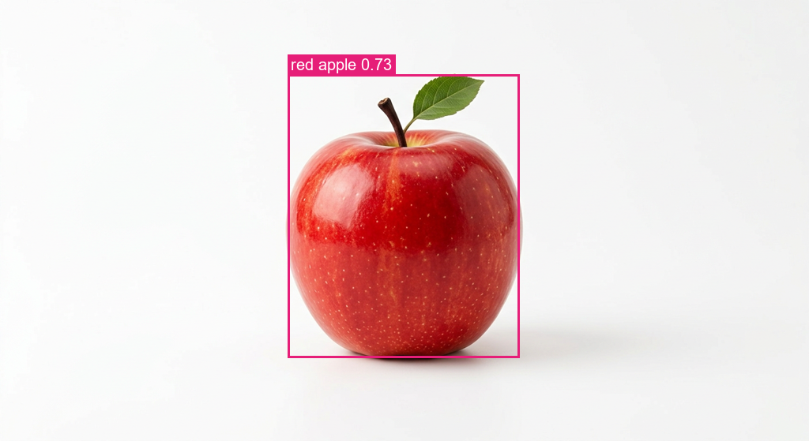

### `orange` — status **detected**, style photo, 1024×559, 16.5s

| object | name | colour | confidence | bbox (x, y, w, h) | origin | user-edited fields | extra |
|---|---|---|---|---|---|---|---|
| orange | orange | orange | 0.83 | 350, 121, 326, 326 | detector | - | - |

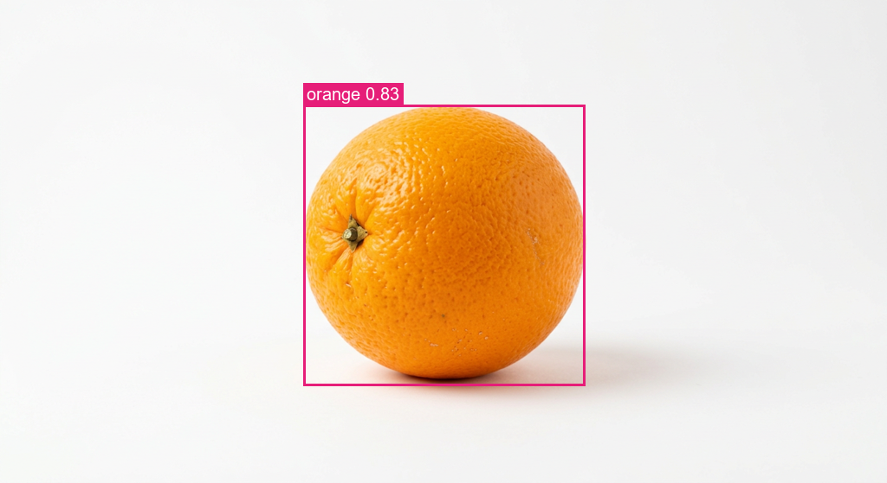

### `boy` — status **detected**, style illustration, 1024×559, 16.6s

| object | name | colour | confidence | bbox (x, y, w, h) | origin | user-edited fields | extra |
|---|---|---|---|---|---|---|---|
| boy | boy | blue | 0.76 | 428, 33, 168, 500 | detector | - | clothing: blue, green, brown |

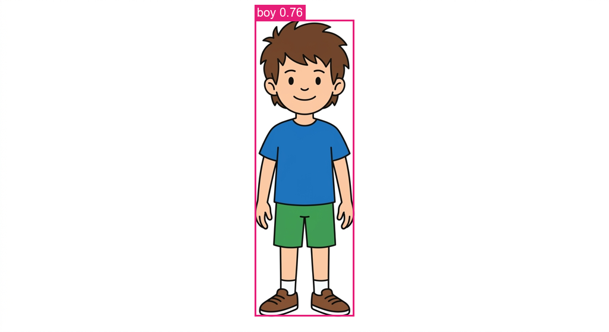

### `girl` — status **detected**, style illustration, 1024×559, 16.8s

| object | name | colour | confidence | bbox (x, y, w, h) | origin | user-edited fields | extra |
|---|---|---|---|---|---|---|---|
| girl | girl | pink | 0.57 | 421, 30, 183, 500 | detector | - | clothing: pink, brown |

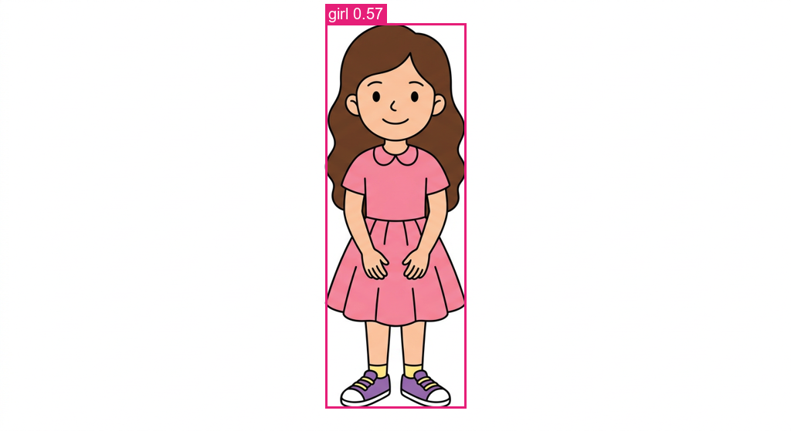

### `shapes` — status **detected**, style illustration, 800×600, 16.3s

| object | name | colour | confidence | bbox (x, y, w, h) | origin | user-edited fields | extra |
|---|---|---|---|---|---|---|---|
| green triangle | triangle | green | 0.99 | 49, 339, 223, 202 | detector | - | - |
| red circle | circle | red | 0.99 | 60, 80, 201, 201 | detector | - | - |
| yellow rectangle | rectangle | yellow | 1.00 | 400, 380, 341, 131 | detector | - | - |
| blue square | square | blue | 1.00 | 460, 80, 201, 201 | detector | - | - |

Ground-truth check: red circle: IoU 1.000, name ✅, colour ✅ · blue square: IoU 1.000, name ✅, colour ✅ · green triangle: IoU 0.986, name ✅, colour ✅ · yellow rectangle: IoU 1.000, name ✅, colour ✅

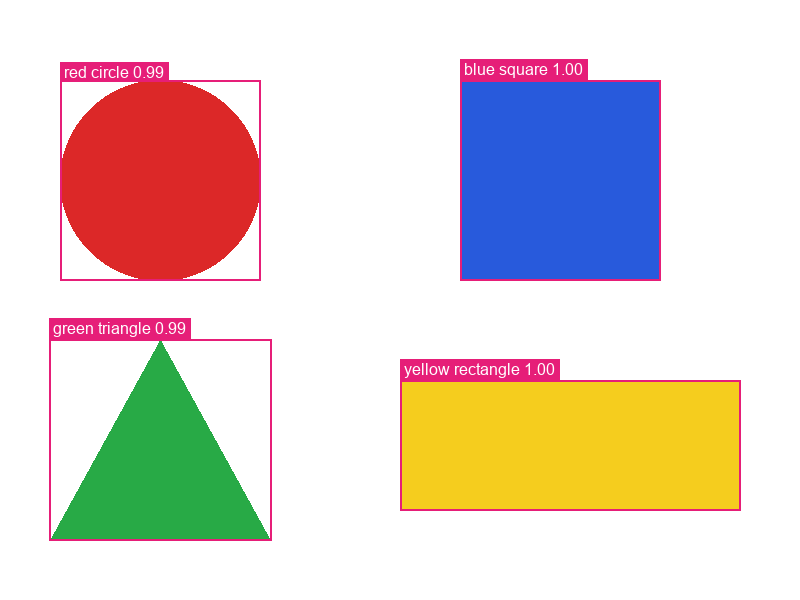

### `colors` — status **detected**, style illustration, 800×600, 16.3s

| object | name | colour | confidence | bbox (x, y, w, h) | origin | user-edited fields | extra |
|---|---|---|---|---|---|---|---|
| red swatch | color swatch | red | 1.00 | 40, 200, 120, 200 | detector | - | - |
| blue swatch | color swatch | blue | 1.00 | 190, 200, 120, 200 | detector | - | - |
| green swatch | color swatch | green | 1.00 | 340, 200, 120, 200 | detector | - | - |
| yellow swatch | color swatch | yellow | 1.00 | 490, 200, 120, 200 | detector | - | - |
| purple swatch | color swatch | purple | 1.00 | 640, 200, 120, 200 | detector | - | - |

Ground-truth check: red swatch: IoU 1.000, name ✅, colour ✅ · blue swatch: IoU 1.000, name ✅, colour ✅ · green swatch: IoU 1.000, name ✅, colour ✅ · yellow swatch: IoU 1.000, name ✅, colour ✅ · purple swatch: IoU 1.000, name ✅, colour ✅

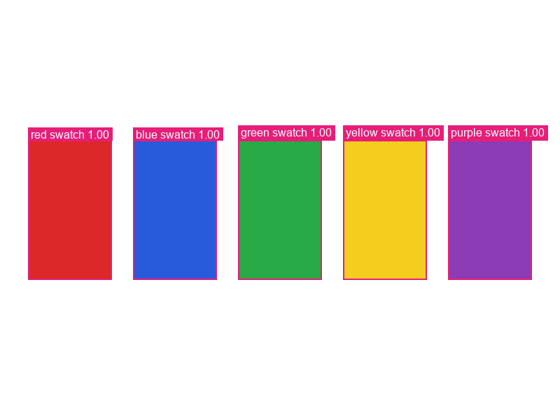

### `apple_orange` — status **detected**, style photo, 1024×559, 17.2s

| object | name | colour | confidence | bbox (x, y, w, h) | origin | user-edited fields | extra |
|---|---|---|---|---|---|---|---|
| red apple | apple | red | 0.72 | 194, 119, 293, 324 | detector | - | - |
| orange | orange | orange | 0.74 | 531, 134, 306, 309 | detector | - | - |

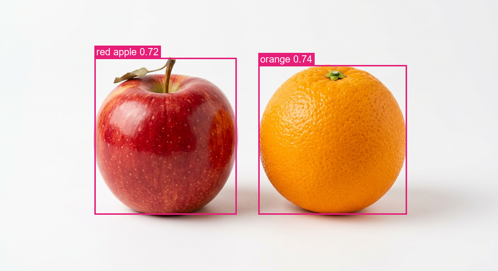

### `overlapping_shapes` — status **detected**, style illustration, 800×600, 16.8s

| object | name | colour | confidence | bbox (x, y, w, h) | origin | user-edited fields | extra |
|---|---|---|---|---|---|---|---|
| blue square | square | blue | 1.00 | 120, 120, 261, 261 | detector | - | occluded by red circle (81% visible) |
| red circle | circle | red | 0.99 | 290, 200, 242, 242 | detector | - | occluded by green triangle (85% visible) |
| green triangle | triangle | green | 0.98 | 440, 98, 262, 263 | detector | - | - |

Ground-truth check: blue square: IoU 1.000, name ✅, colour ✅ · red circle: IoU 0.992, name ✅, colour ✅ · green triangle: IoU 0.989, name ✅, colour ✅

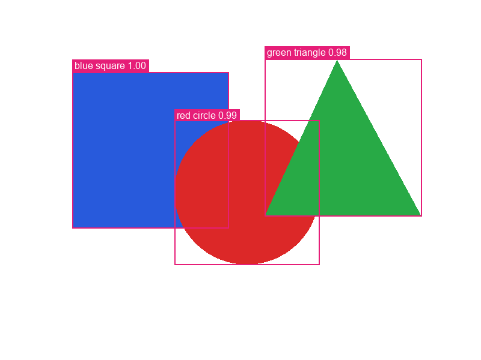

## Scenario 2 — manually add an object the detector missed

`camouflage` hides a square that is only ~6 grey levels brighter than its textured background. Detection status: **no_objects** with 0 objects (note: background not plain (uniformity 0.83); segmentation skipped; OWLv2 finds nothing above threshold).

User adds `square` → object `7f5b60026a53` origin `user`, image objects_source **manual**.

| object | name | colour | confidence | bbox (x, y, w, h) | origin | user-edited fields | extra |
|---|---|---|---|---|---|---|---|
| square | square | gray | 1.00 | 320, 220, 160, 160 | user | bbox, category, color, confidence, name, notes | - |

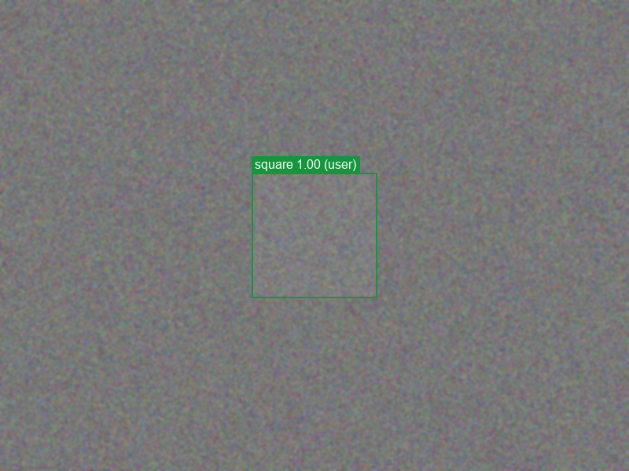

## Scenario 3 — edit name, colour, confidence and bounding box

| field | detector value (`auto`, read-only) | user override (`user`) | effective |
|---|---|---|---|
| apple.display_name | red apple | Gala apple | Gala apple |
| apple.confidence | 0.719 | 1.0 | 1.0 |
| apple.bbox | {'x': 194, 'y': 119, 'width': 293, 'height': 324} | {'x': 190, 'y': 115, 'width': 301, 'height': 332} | {'x': 190, 'y': 115, 'width': 301, 'height': 332} |
| orange.name | orange | mandarin | mandarin |

Deleted the purple swatch from `colors` → 4 live objects (detector objects are tombstoned with `user.deleted = true`, so a later run can't bring them back silently).

| object | name | colour | confidence | bbox (x, y, w, h) | origin | user-edited fields | extra |
|---|---|---|---|---|---|---|---|
| Gala apple | apple | red | 1.00 | 190, 115, 301, 332 | detector | bbox, confidence, display_name | - |
| mandarin | mandarin | orange | 0.74 | 531, 134, 306, 309 | detector | category, color, name | - |

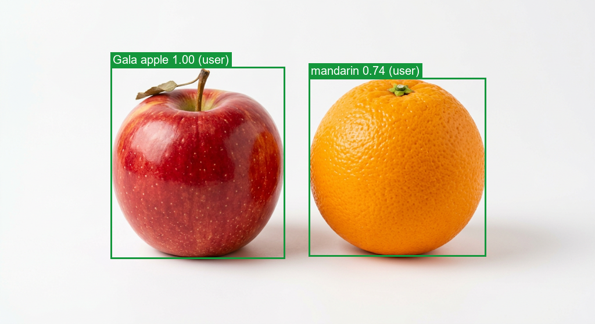

## Scenario 4 — corrections persist until detection is explicitly re-run

`run_detection(apple_orange)` → **refused**: _image ed1153a40898 has manual objects; they are the source of truth. Pass force=True to explicitly re-run detection and replace them._

After restart: objects_source **manual**, objects ['Gala apple', 'mandarin'], purple swatch still deleted: True

`run_detection(apple_orange, force=True)` → objects_source **auto**, objects ['orange', 'red apple']. Detection history has 2 runs; the forced run archived 2 replaced objects (including the user's edits) in `detection_runs.replaced`.

## Scenario 5 — composite: “Create an image containing one red apple and one orange”

Planner: `llm:anthropic/claude-haiku-5.5` · layout `row` · 939×546 · 19.5s · new catalog entry `44eed94917e6` (kind **composite**, objects_source **composition**)

| placed object | source image | source bbox | mask | scale | placed bbox | z |
|---|---|---|---|---|---|---|
| red apple | `apple` | 364,94,294,360 | stored detection mask | 1.1667 | 63,63,343,420 | 0 |
| orange | `orange` | 350,121,326,326 | stored detection mask | 1.2883 | 456,63,420,420 | 1 |

Self-check (detector re-run on the composite): all placed objects found = **True** — apple→apple (IoU 0.914), orange→orange (IoU 1.0)

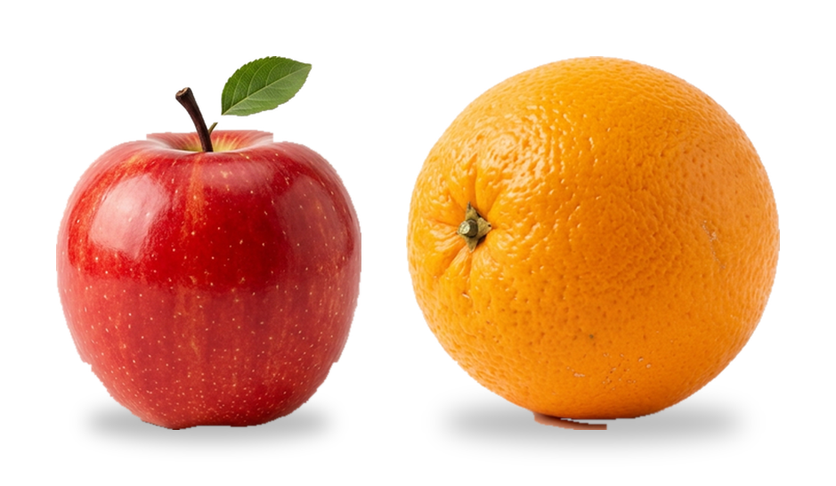

## Scenario 6 — composite: “Create an image containing a boy, a girl, and colored shapes”

Planner: `llm:anthropic/claude-haiku-5.5` · layout `row` · 791×546 · 20.4s · new catalog entry `6dfb477bcff8` (kind **composite**, objects_source **composition**)

| placed object | source image | source bbox | mask | scale | placed bbox | z |
|---|---|---|---|---|---|---|
| boy | `boy` | 428,33,168,500 | stored detection mask | 0.84 | 63,63,141,420 | 0 |
| girl | `girl` | 421,30,183,500 | stored detection mask | 0.805 | 254,81,147,402 | 1 |
| yellow rectangle | `shapes` | 400,380,341,131 | stored detection mask | 0.3695 | 451,284,126,48 | 2 |
| blue square | `shapes` | 460,80,201,201 | stored detection mask | 0.6269 | 602,206,126,126 | 3 |
| red circle | `shapes` | 60,80,201,201 | stored detection mask | 0.6269 | 451,357,126,126 | 4 |
| green triangle | `shapes` | 49,339,223,202 | stored detection mask | 0.5753 | 602,368,126,115 | 5 |

Self-check (detector re-run on the composite): all placed objects found = **True** — boy→boy (IoU 1.0), girl→girl (IoU 1.0), rectangle→rectangle (IoU 0.972), square→square (IoU 1.0), circle→circle (IoU 1.0), triangle→triangle (IoU 0.984)

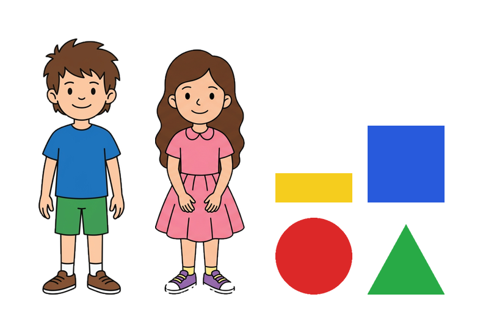

## Scenario 6b — composite: “Overlapping red circle, blue square and green triangle on a yellow background”

Planner: `llm:anthropic/claude-haiku-5.5` · layout `overlap` · 1134×546 · 20.6s · new catalog entry `75330d671e7d` (kind **composite**, objects_source **composition**)

| placed object | source image | source bbox | mask | scale | placed bbox | z |
|---|---|---|---|---|---|---|
| red circle | `shapes` | 60,80,201,201 | stored detection mask | 2.0896 | 63,63,420,420 | 0 |
| blue square | `shapes` | 460,80,201,201 | stored detection mask | 2.0896 | 357,63,420,420 | 1 |
| green triangle | `overlapping_shapes` | 440,98,262,263 | stored detection mask | 1.6216 | 651,63,420,420 | 2 |

Self-check (detector re-run on the composite): all placed objects found = **True** — circle→circle (IoU 0.717), square→square (IoU 0.998), triangle→triangle (IoU 0.941)

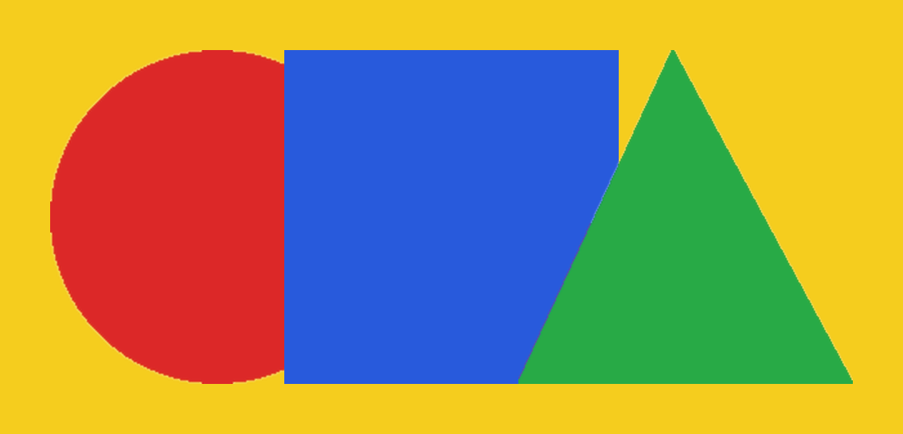

### Missing asset — no silent substitution

`compose('an apple and a banana')` → **MissingAssetError**: _the catalog has no asset for: banana. Add an image containing it first; the composer never substitutes generated approximations._

## Scenario 7 — overlapping objects, no detectable objects, failures

`overlapping_shapes`: 3 objects, overlapping boxes, occlusion order recovered (see scenario 1 table). Pairwise IoU of the detected boxes: blue square/red circle 0.15, blue square/green triangle 0.00, red circle/green triangle 0.13

- `blank` → status **no_objects**, 0 objects
- `noise` → status **no_objects**, 0 objects, error: `background not plain (uniformity 0.80); segmentation skipped`
- `truncated` → status **failed**, 0 objects, error: `OSError: image file is truncated`

`no_objects` is a successful run that found nothing; `failed` means the run itself broke (here a truncated PNG). In both cases the user can add objects manually as in scenario 2.

