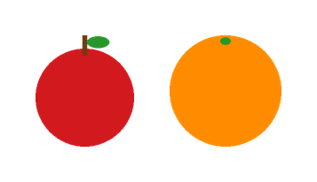
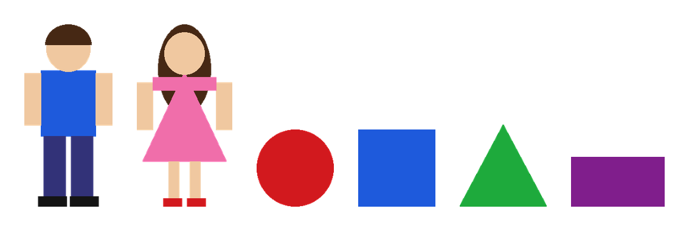

# Question 1: Image Catalog, Object Detection, Metadata, Composite Generation

```bash
python -m q1_image_catalog.demo                 # all 7 scenarios, outputs in examples/q1/
python -m pytest q1_image_catalog -q            # 20 tests
python -m q1_image_catalog --root data/catalog seed
python -m q1_image_catalog --root data/catalog compose "one red apple and one orange"
```

Results from the offline run: [examples/q1/DEMO_LOG.md](../examples/q1/DEMO_LOG.md). The annotated detections are in
[examples/q1/detections/](../examples/q1/detections/) (green = detector, magenta = added by a user, orange = edited by a user).

| Apple + orange composite | Boy + girl + shapes composite |
|---|---|
|  |  |

## Architecture

```
            add_image()                         compose("one red apple and one orange")
                │                                            │
   ┌────────────▼────────────┐              ┌────────────────▼─────────────────┐
   │ Catalog (catalog.py)    │              │ Composer (compose.py)            │
   │ SQLite: images, objects │◄─────────────┤ parse -> resolve -> cut out ->   │
   │ files: images/<id>.png  │  new entry   │ scale -> place -> layer -> save  │
   └────────────┬────────────┘ + provenance └──────────────────────────────────┘
                │ run_detection()
   ┌────────────▼──────────────────────────────────────────┐
   │ Detector protocol: detect(PIL.Image) -> DetectionResult│
   │  ClassicalDetector     offline, deterministic          │
   │  ClaudeVisionDetector  CV proposals + Claude labels    │
   └────────────────────────────────────────────────────────┘
```

| File | Role |
|---|---|
| `catalog.py` | Storage, metadata, manual-correction rules, the line between auto and user fields |
| `detect.py` | Detection backends |
| `compose.py` | Request parsing, asset lookup, matting, layout, provenance |
| `testdata.py` | Draws the section-6 test images in code (same pixels every run) plus 3 failure cases |
| `__main__.py` / `demo.py` | CLI and scenario walkthrough |

## Detection

**ClassicalDetector** (default when there is no API key). It needs no network and returns the same result every run:

1. **Background model.** Takes the median colour of the image border. If the border is noisy (spread above 25), it reports
   `status=failed` with a reason and does not guess. This is how the `cluttered` photo-like image is handled.
2. **Foreground.** Marks pixels far from the background colour (RGB distance above 60), cleans them with a morphological
   open, then finds connected components.
3. **Colour naming.** Puts every pixel in an HSV bucket (red, orange, skin, blue, and so on) using vectorised numpy.
4. **Per component:**
   - *Skin-toned region plus 3 or more colour regions* → `person`. Clothing colours go in `attributes.colors`.
   - *Several flat colour regions that each fit a geometric primitive* → overlapping shapes. Each region becomes its own
     object, and the bounding boxes may overlap.
   - *Single object* → shape classification on the convex hull (polygon vertex count, circularity, fit to the
     minimum enclosing shape). The convex hull keeps partly hidden shapes classifiable. A round red or orange object
     with detail (stem, leaf, shading) is labelled fruit; a flat disc of one colour is labelled `circle`.
5. **Confidence** is the geometric fit score. Heuristic labels such as `person` get a fixed lower confidence (0.6).

**ClaudeVisionDetector** (used when `ANTHROPIC_API_KEY` is set, or with `--detector claude`). The classical regions are
sent to Claude as *pixel-accurate proposals* along with the image. Claude names each one (`boy` rather than `person`)
and can add objects that have no proposal. Boxes from the proposals are kept because the segmenter is more precise
than boxes drawn by the model. A backend error becomes a `failed` detection run; it never breaks image ingestion.
Tests cover this backend with a fake model.

This split covers both kinds of image. Cartoons and flat graphics are handled well by the classical detector.
Photographs are handled by the vision model, which is also given proposals when the background allows it.

## Metadata and source of truth

```jsonc
{
  "id": "…", "name": "boy",
  "auto": { "width", "height", "sha256", "kind": "upload|composite", "created_at", "provenance",
            "detection": { "status": "detected|no_objects|failed|skipped", "backend", "error", "ran_at", "runs" } },
  "user": { "display_name", "description", "tags": {…} },
  "corrected": true,
  "objects": [{ "id", "origin": "detector|user|composer", "detector", "edited_by_user": true,
                "label", "display_name", "color", "confidence", "bbox": {"x","y","w","h"}, "attributes",
                "auto_original": { "label": "person", "confidence": 0.6, … } }]
}
```

* Only fields in the `user` section, and the object fields `label, display_name, color, confidence, bbox, attributes`,
  can be edited. Any attempt to edit a system field (`width`, `detector`, …) raises an error. Bounding boxes are checked
  against the image size, and confidence must be between 0 and 1.
* The first user edit to a detector object saves the detector's values in `auto_original`, so the original output is
  never lost.
* **Corrections are the source of truth.** Any add, edit or delete marks the image `corrected`. After that:
  * `run_detection(img)` raises `ManualCorrectionsExist`.
  * `redetect_all()`, the batch job you would run after a detector upgrade, skips the image.
  * Detection only runs again when the user asks: `force=True` replaces everything, and `force=True, keep_manual=True`
    replaces only detector objects the user has not touched.

## Composite generation

1. **Parse.** The offline path is a rule-based grammar (`"one red apple and one orange"` → `[apple×1 red, orange×1]`;
   a bare plural like `"colored shapes"` means *all* of them; `"orange"` is read as a noun when nothing else in the
   phrase is). With an API key, Claude parses free-form wording, but its terms are limited to the catalog vocabulary.
2. **Resolve.** Each item is matched to an object label or display name first, and to an image name second. When
   several assets match, the order of preference is: an image named after the item, then images with fewer objects
   (cleaner assets), then user-verified objects, then higher confidence. Composites are never used as sources.
   **If anything is missing, the request fails with `MissingAssetError`** and the error lists the available vocabulary.
   The composer never generates or substitutes pixels: `provenance.generated_pixels` is always `false`.
3. **Cut out.** Crops the object's bounding box and builds an alpha matte from the background model. It keeps the
   largest connected part, which drops pieces of neighbouring objects. For objects split from overlapping shapes, it
   also keeps only the object's own colour.
4. **Scale, position and layer.** Each category has a size prior (people 1.0, fruit 0.42, everything else 0.45). Each
   requested item gets one scale, so a group such as "shapes" keeps its relative sizes. Items sit in a row on a shared
   ground line and are alpha-composited tallest first, so smaller items end up in front.
5. **Save.** The composite becomes a new catalog entry (`kind=composite`). Its objects come straight from the layout,
   so no detection is needed. Provenance records the request, the parsed items, and for every layer the source image
   and object, the scale, where it was placed, and its z-order.

## Trade-offs and what's next

| Decision | Why | Cost |
|---|---|---|
| Classical CV + optional vision model, instead of shipping a COCO detector | Runs offline and gives the same result every time. Tests can check exact behaviour. COCO has no labels for cartoon boy/girl or shapes. | Heuristic labels (`person`) need either the vision backend or a manual fix |
| CV proposals labelled by the VLM | Exact boxes plus meaningful labels | One API call per image |
| SQLite + files | No server to run, transactional edits, easy to move to Postgres | Only one writer at a time |
| Row layout | Predictable and readable | No spatial wording yet ("apple on the table") |
| Hard failure on missing assets | Meets the "never silently replace" requirement | The user has to add or label the asset first |

Next steps: segmentation masks per object (for example SAM) instead of matting from the bounding box; spatial
relations in the parser ("left of", "on top of"); a small FastAPI layer over `Catalog` for a web UI.
